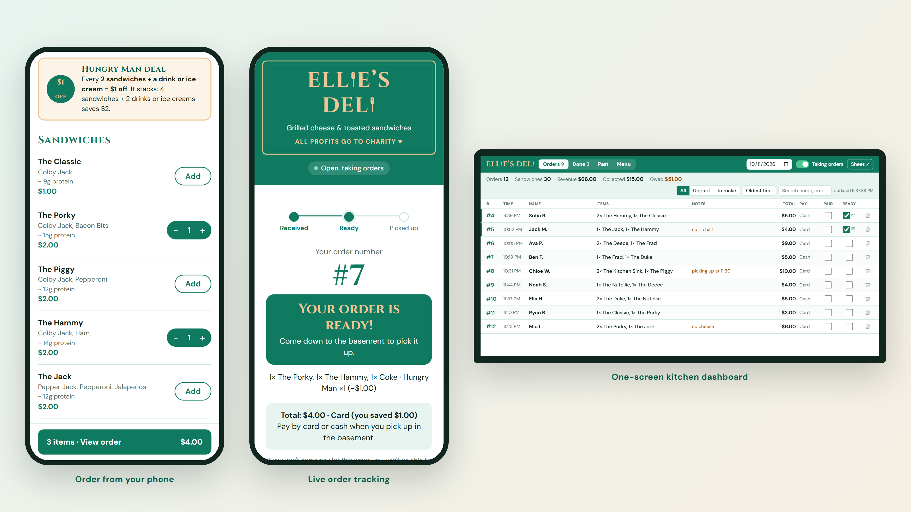
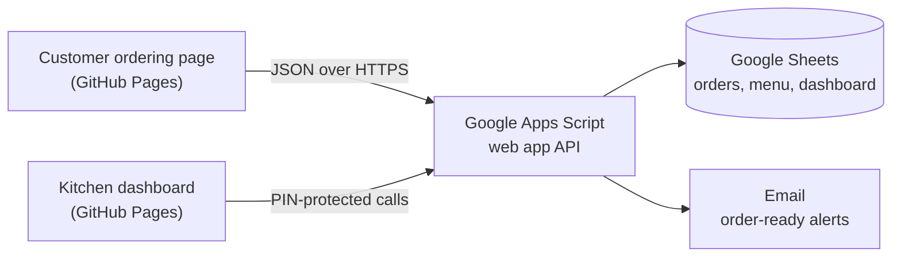

# Ellie's Deli: online ordering

Mobile ordering, live order tracking and a one-screen kitchen dashboard for Ellie's Deli, a student-run late-night sandwich counter at the University of Notre Dame. All profits go to charity.

**[Live site](https://anthonyghauch.github.io/ellies-deli/)** · Built and run by Anthony Ghauch



## Why I built it

The deli took orders through a Google Form. In the kitchen that meant flipping through responses one page at a time, with nowhere to mark who had paid and no way to tell customers their food was ready. I work shifts at the deli, so I built the replacement around what actually slowed the kitchen down.

## Impact

In its first 6 nights:

- **170+ orders** and **$670+ in sales**
- **90+ customers** ordered, and **52% came back** on another night, placing 74% of all orders
- **30+ releases** in under 4 weeks, most of them from problems spotted during shifts

## What it does

**For customers**
- Menu with ingredients, protein estimates, and sold-out items greyed out
- Cart that applies the Hungry Man combo deal automatically and suggests the item that unlocks it
- How many orders are ahead before ordering, then a live place in line, a chime and an email when the order is ready
- Self-service cancel until the kitchen marks the order ready
- Installable home-screen app, and a cart that survives a refresh

**For the kitchen**
- All of tonight's orders on one auto-refreshing screen, with Paid and Ready checkboxes
- Done and Past tabs, search and filters, and a switch to open or close ordering
- Sold-out switches and an on/off switch for the deal
- Every order saved to Google Sheets, with a dashboard of revenue, best sellers and sales per night

## How it works



## Engineering highlights

- **No servers, $0 a month.** A static site on GitHub Pages, deployed by GitHub Actions on every push, talks to a Google Apps Script JSON API that uses Google Sheets as its database.
- **Prices are set by the server.** The backend re-prices every order from the Menu sheet and applies the deal itself, so totals can't be changed in the browser.
- **Retries never double an order.** Google occasionally drops a reply, so the site retries, and every order carries a request ID that the backend uses to ignore duplicates.
- **Order numbers stay consistent under load.** Placing, cancelling and deleting orders, and ticking Paid or Ready, all run under a script lock.
- **Only the customer can cancel their order.** Each order gets an HMAC-signed cancel key.
- **Fast live status.** A 10-second cache of each night's orders answers "how many orders are ahead" without rereading the sheet on every poll.
- **Two installable apps.** The customer page and the kitchen page each have their own manifest, icons and scope, so both can sit on the same phone.

## Built from the kitchen floor

Since launch on October 11, 2026, most updates have come from things I noticed while working shifts:

- Done and Past tabs, so finished and old orders stop cluttering the night's list
- A live "orders ahead of you" counter, before and after ordering
- Customer self-cancel, sold-out switches, and the Hungry Man deal with its on/off switch
- A home-screen app, a saved cart, ice cream, and protein estimates

## Tech stack

JavaScript · HTML/CSS · Google Apps Script · Google Sheets · GitHub Pages · GitHub Actions · Progressive Web App (installable web app)

## Repository layout

```
site/        the website (published to GitHub Pages)
  index.html   customer ordering page
  admin.html   kitchen dashboard
  poster.html  printable QR-code poster with the menu
backend/     Google Apps Script backend (Code.gs) and its settings
print/       ready-to-print poster and QR cards
docs/        setup and operations guide, screenshots
```

## Run your own copy

Open `site/index.html` in a browser to try it with fake data (demo mode, kitchen PIN `1234`). To connect it to your own Google Sheet and put it online, follow the [setup and operations guide](docs/OPERATIONS.md).
